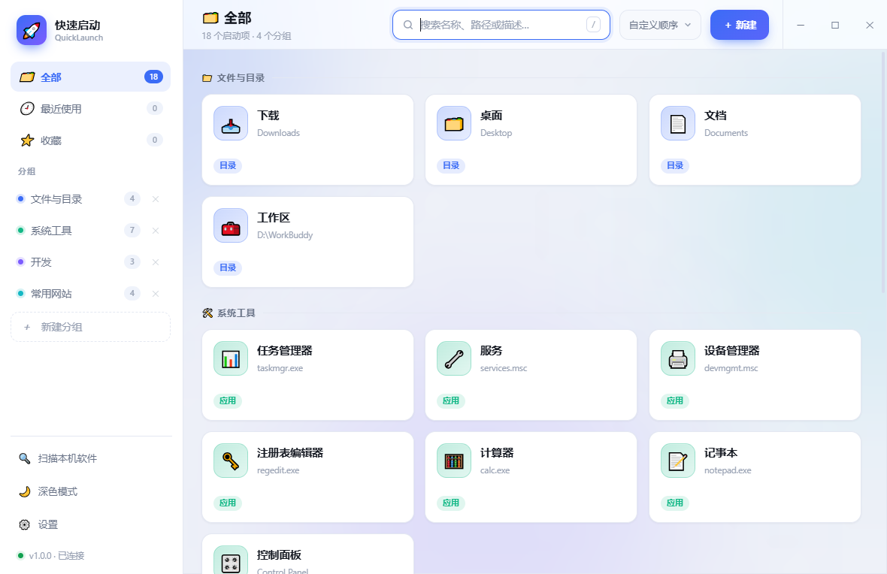
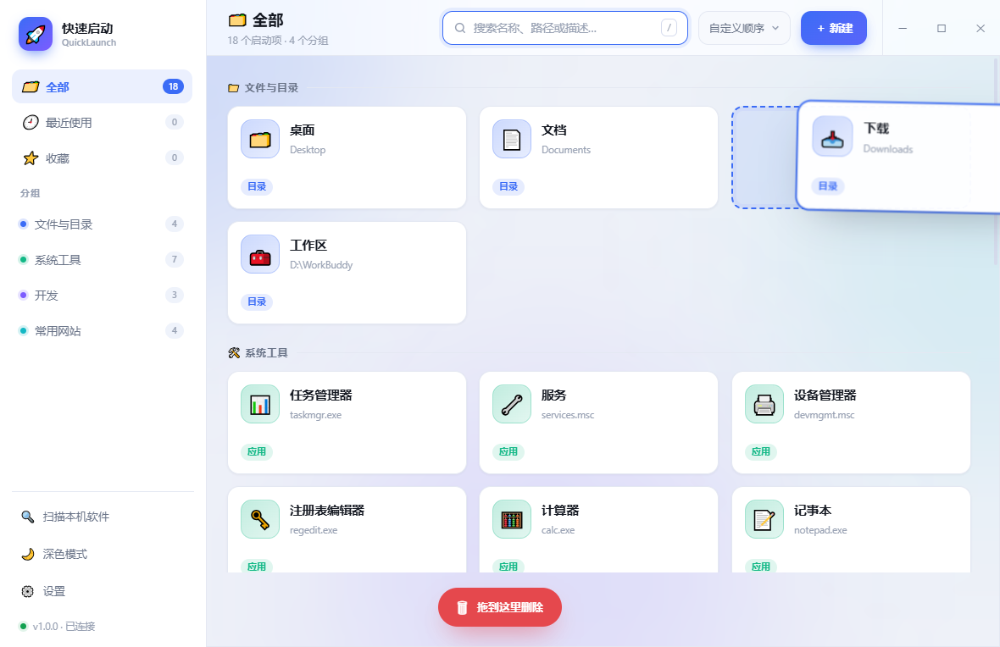
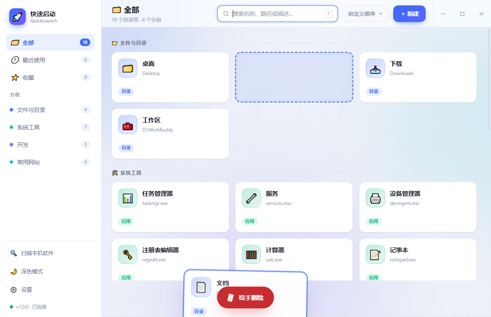
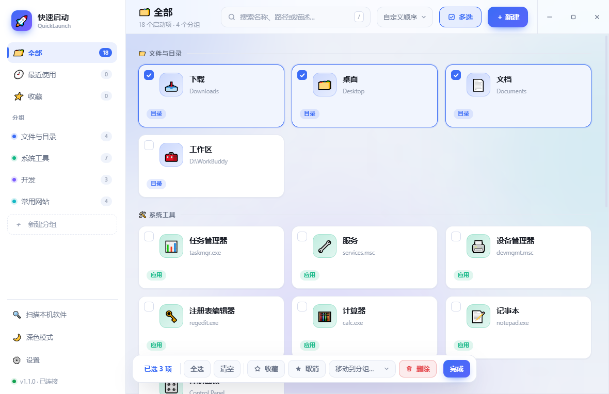
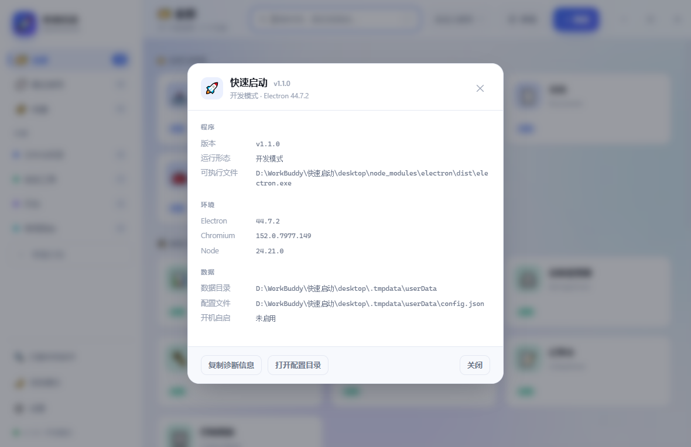

# 快速启动 · QuickLaunch

一个 Windows 桌面启动器：把常用的程序、目录、网址、脚本收进一个干净的面板，
托盘常驻、全局热键一按就出来，拖进去就能加。

<p align="center">
  
</p>

## 特性

| | |
|---|---|
| **托盘常驻** | 关窗口不退出，缩进托盘继续待命；单击托盘/按热键随时呼出 |
| **全局热键** | 默认 `Ctrl+Alt+Space`，可改；呼出即聚焦搜索框。被别的程序占用时设置里会提示注册失败 |
| **搜索** | 按名称 / 路径 / 描述过滤，也支持**拼音**：小写全拼（`jishiben`）或首字母（`jsb`）都能搜到中文名 |
| **开机自启** | 可选开机静默到托盘。写的是**当前 exe 的路径**，便携版/绿色版换目录后回设置里重新勾一次 |
| **拖入导入** | 文件 / 文件夹 / 网址直接拖进窗口，自动分类（app / script / dir / url），**逐项显示导入进度**，单次最多 500 项。`.url` 快捷方式（Steam 之类）会取它自己写的图标，见下「拖进来的游戏快捷方式」。★ 若把程序设成「以管理员身份运行」，Windows 会禁止资源管理器把文件拖进管理员窗口（UIPI）—— 那时**连遮罩都不会出现**，不是坏了 |
| **长按排序** | 长按卡片 **0.5 秒**进入拖动模式，拖到新位置松手即重排；拖到底部**垃圾桶**松手删除。**多选模式下**按住 **0.3 秒**就能拖动排序（点一下仍然是勾选） |
| **拖到分组** | 拖动时把卡片拖到左侧**分组名**上松手，就直接移进那个分组：多选时整批搬、普通模式就是这一张（v1.5.3 / v1.5.4）。拖到自己所在的分组不会高亮也不会动 |
| **点卡片不闪** | 启动后只把那张卡的「用过 N 次」就地 +1，不重绘整个界面（v1.5.2 修掉了点一下像刷新一次的问题） |
| **多选编辑** | 点右上角**多选**进编辑模式，勾一堆卡片后批量**收藏 / 取消收藏 / 移动分组 / 删除**；也可以把这堆卡片**直接拖到左侧分组上**一次搬过去（v1.5.3） |
| **清理无效项** | 设置里「检查无效项…」或空白处右键：列出**路径确实不存在**的启动项，勾选后一次清掉（v1.5.5）。★ 只认「确定失效」：U 盘没插、网络盘、只写命令名的项都归“存疑”，默认不勾；删除前自动备份到 `data\backup\`，清理完可一键撤销 |
| **界面动画开关** | 设置里可以整体关掉界面动画（卡片入场、提示滑入滑出、分组浮入等），关掉后拖动/切换就不会再闪一下；长按拖动的进度提示属于**功能反馈**，不受影响（v1.5.7） |
| **设置分区** | 设置面板按「多久动一次」分成四组可折叠分区：启动与热键 / 窗口与外观（默认展开）、启动项维护 / 软件更新（默认收起，标题上直接显示当前值）；展开状态会记住，页脚会提示「有未保存的修改」（v1.5.8） |
| **拖入落点** | 拖到侧栏分组上 → 进那一组；**站在某个分组里拖进来 → 直接进当前分组**；只有「全部 / 最近 / 收藏」里拖入才落到「拖入的快捷方式」，此时提示条上多一颗「分配到分组…」——点一下把这批预先勾好，选一次分组就整批搬走（v1.5.9） |
| **分组管理** | 侧栏「＋ 新建分组」；右键可重命名 / 换颜色 / 删除。删除只在右键菜单里，不占侧栏。误删了默认分组（文件与目录 / 系统工具 / 开发 / 常用网站）可在 **设置 → 恢复默认分组** 里补回来 |
| **分组排序** | 左侧栏分组**按住直接拖**就能改顺序（「全部 / 最近使用 / 收藏」和「新建分组」不参与） |
| **启动分组** | 可选每次打开停在哪个分组（默认**记住上次**），不必固定是「全部」 |
| **扫描导入** | 扫开始菜单 + 注册表，批量勾选已安装软件一键导入；**导入时显示进度**，过程中不可取消也不会重复导入 |
| **图标支持** | 导入/扫描软件时**自己解 `.exe` 的 PE 资源**提取自带图标（不依赖时好时坏的 `app.getFileIcon`，见下「为什么以前成片都是同一个图标」）；编辑弹窗可「选择图片…」用任意图片自定义图标，或「还原默认图标」/「清除自定义」 |
| **两种主题** | 深色 / 浅色，跟随设置持久化 |
| **自绘标题栏** | 无边框窗口 + 内联 SVG 窗口按钮（不依赖系统字体，小字号也清晰） |
| **关于 / 运行环境** | 侧栏左下角点**版本号**（或设置里的「关于」）看版本、运行形态、数据落点与环境版本，一键**复制诊断信息** |
| **软件更新** | 启动时**静默查一次**更新（可关）；发现新版本会在侧栏提示，**下载与安装永远等你点**。见下「关于联网」 |
| **本机优先** | 不注册账号、不上报任何使用数据；配置只写在本机（程序目录的 `data\`） |

<table>
<tr>
<td></td>
<td></td>
</tr>
<tr>
<td></td>
<td></td>
</tr>
</table>

## 多选编辑

点右上角 **多选**（或卡片/空白处右键 →「多选编辑…」）进入编辑模式：卡片左上会出现勾选框，
点卡片即勾选，底部浮出一条操作栏 —— 批量**收藏 / 取消收藏 / 移动分组 / 删除**。

<p align="center">
  
</p>

* 快捷键：`Esc` 或「完成」退出，`Ctrl+A` 全选当前列表，`Delete` 批量删除。
* 多选模式下也能**拖动排序**：按住卡片 0.3 秒即进入拖动（点一下仍是勾选）；这时不会出现垃圾桶，只调整顺序。
* 勾好一堆卡片后，直接**拖到左侧的分组**上松手，整批就搬过去了：目标分组会高亮并显示「移入 N 项」；拖到虚拟视图（全部 / 最近使用 / 收藏）上不生效。
* 不想先进多选也行：**普通模式**下长按 **0.5 秒**起拖，直接拖到左侧分组上松手就是「这一张移过去」（单张时提示「移到这里」）。拖到自己所在的分组不会高亮，也不会误动顺序。
* 切换分组 / 收藏视图 / 搜索会**清空勾选** —— 免得看不见的选中项被一起删掉。
* 进编辑模式时「新建启动项」卡片会隐藏，避免把"新建"误当成"勾选"。
* 删除只在右键菜单和编辑模式里，日常误触不到。

## 清理无效项

设置 →「检查无效项…」（或空白处右键 →「清理无效项…」）会逐项检查路径，结果分成两组：

* **确定失效** —— 绝对路径、所在磁盘当前在、系统明确回报"文件不存在"。这组默认勾选。
* **存疑** —— U 盘 / 移动硬盘没插、网络位置、只写了命令名（如 `powershell.exe`）、相对路径、没权限确认。
  这组**默认不勾**，点「全选」也不会选它们：看不到 ≠ 不存在。

清理前会把完整内容备份到 `data\backup\invalid-日期-时间.json`，备份写不出来就整批放弃（一个都不删）。
清理完成后弹窗里直接有「撤销这次清理」，按原分组放回去。

> 判断只在主进程做一次、删除前再判一次 —— 界面传来的 id 不可信；只删「确定失效」，存疑项即使被硬塞 id 也会被挡回来。

## 右键菜单

| 在哪儿右键 | 能做什么 |
|---|---|
| **卡片** | 启动 / 以管理员身份启动 / 打开所在位置 / 收藏 / 编辑 / 删除 |

> 「打开所在位置」会在资源管理器里定位到**程序真正所在的位置**：只写了命令名（如 `notepad.exe`）的项会先解析成完整路径；快捷方式（`.lnk`）会跟到它指向的程序，而不是停在开始菜单。

| **左侧分组** | 新建分组 / 重命名 / 换颜色 / 删除分组 |
| **空白处** | 新建启动项 / 多选编辑 / 扫描已安装软件 / 清理无效项 |

## 启动时打开哪个分组

设置 →「启动时打开」，可选：

| 选项 | 行为 |
|---|---|
| **记住上次打开的分组**（默认） | 上次停在哪个分组，下次就打开哪个（含「最近使用 / 收藏」） |
| 全部 / 最近使用 / 收藏 | 固定停在这个视图 |
| 指定分组 | 固定停在某个分组。该分组被删掉后会自动回落到「全部」 |

## 三种发布形态

一共有三种产物，但**本地和 GitHub Release 出的不是同一套**：

| 产物 | 文件名 | 说明 | 本机 `npm run dist` | GitHub Release |
|---|---|---|---|---|
| **安装版** | `QuickLaunch-Setup-<版本>.exe` | NSIS 安装包。可选安装目录，自动建桌面 + 开始菜单快捷方式，带卸载项 | ✅ | ✅ |
| **绿色版** | `QuickLaunch-Green-<版本>.zip` | 解包即用的整个目录，exe 在 zip 根层，解压到哪就在哪跑 | ✅ | ✅ |
| **便携版** | `QuickLaunch-Portable-<版本>.exe` | 单文件绿色 exe，双击即用，不写注册表。数据写在 **exe 所在目录**下 | ✅ | ❌ 不出 |

> **为什么 Release 不出便携版？** 单文件 exe 体积与安装版接近（≈111 MB），却多一份需要维护的
> 打包路径；Release 页面留「安装版 + 绿色版」两个入口已经覆盖了全部使用场景。
> 需要便携版请按下面的「从源码构建」自己打一个，命令原样保留。

CI 与本地产出的两个文件**版本号与文件名一致**（两台机器分别构建，字节不完全相同）。

## 数据存在哪

**数据随程序走** —— 三种形态都把配置写在**程序所在目录**的 `data\` 子目录里，
拷走整个目录（或整个安装目录）就能把配置一起搬走：

| 形态 | 数据落点 |
|---|---|
| 安装版 | `<安装目录>\data\` |
| 绿色版 | `<运行目录>\data\` |
| 便携版 | `Portable\data\`（**exe 所在目录**，不是临时解包目录） |
| 开发模式 | `<项目>\desktop\.tmpdata\userData\` |

只有**程序目录不可写**时（例如装进了 `C:\Program Files` 又没提权），才回落到系统目录
`%APPDATA%\QuickLaunch\`；此时设置面板顶部会出现一条警示条，侧栏左下角的状态点也会变成红色。
首次在程序目录建 `data\` 时，若 `%APPDATA%` 里已有旧配置，会**复制**一份过去（原文件保留，不会删）。

点侧栏左下角的**版本号**（或设置 →「关于」）会直接告诉你当前落在哪：

<p align="center">
  
</p>

窗口底部还有**复制诊断信息** —— 一键把上面这些内容拷进剪贴板，反馈问题时贴出来就行。

> **升级时注意：先从托盘退出旧版，再打开新版。**
> 单实例锁是跟着**数据目录**走的，而同一种形态的数据目录就在 exe 旁边 —— 所以把新旧两个
> 版本放进**同一个文件夹**时它们共用一份 `data\` 和一把锁。这时双击新版 exe **不会**起第二个
> 进程，只会把已经在运行的那个窗口带到前台（你看到的可能还是旧版界面）。
> 想同时开着新旧两个版本对比，把它们放到**不同文件夹**里即可。
> 程序会把「已有一个实例在运行（v版本 · 运行形态）」明确提示出来，不让你对着旧窗口猜
> 为什么新功能没生效；若**正在运行的那个**版本早于这条提示，它就只会把窗口带到前台 ——
> 那就先退出再打开。

> 侧栏左下角那行只显示版本号（如 `v1.4.5`），运行形态在「关于」里看 —— 那行不是网络状态。
> 那行末尾如果出现 **`· 可更新`**，表示查到了新版本 —— 它不是"在线"，只是更新检查的结果。

### 关于联网（重要）

程序**只做一件事会联网**：启动约 8 秒后，静默去更新源取一个很小的 `update.json`
（默认 `github.com/.../releases/latest/download/update.json`，可在
**设置 → 软件更新 → 更新源** 换成镜像）。除此以外没有任何网络行为：

* **不上报**任何使用数据、不注册账号、不采集统计；
* **不轮询**、不常驻连接，就启动那一次；不想要可以在设置里关掉「启动时自动检查更新」；
* **下载与安装永远等你点** —— 发现新版本只会在侧栏和「关于」里提示，绝不会自己下载或重启。

## 下载

到 [Releases](../../releases) 页面取最新版本。国内直连不稳的话把
`github.com` 换成代理镜像即可。

## 软件更新

**安装版**与**绿色版**都支持在程序内更新（侧栏左下角状态行出现 `· 可更新`，或打开
**关于** → 「软件更新」）：点「检查更新」→「下载」→ 下载完再点「重启并更新」。

* **永远由你决定**：默认只在启动时静默查一次，查到了只提示；**下载和安装都要你点**，
  程序绝不会自己下载或自己重启。
* **换文件是在程序退出之后**由一段后台助手完成的 —— Windows 上运行中的 `exe` 覆盖不了，
  所以只能"先退出、后替换、再自动打开"。替换用的是"先落临时文件再原子改名"，
  中途断电也不会留下半个 exe。
* **助手没起来就绝不退出**：点「重启并更新」之后，程序会先确认那个后台助手**真的跑起来了**
  （它一启动就会在更新目录里写一行日志），确认之后才关自己。万一助手没起来，
  程序会留着窗口把原因告诉你 —— 不会再出现"点完就没了、重开还是旧版"。
  （v1.4.1 修的就是这个：交接时用了一个会让 PowerShell 静默不执行的启动方式。）
* **差量下载**：如果更新源里有从你这个版本出发的补丁，只会下载**改动的那部分**
  （实测 1.0.2 → 1.1.0：整包 153 MiB，差量 **0.25 MiB**）。没有对应补丁或占比过大时
  自动退回整包，不需要你选。
* **绝不碰你的配置**：`data\`、`.update\` 这些运行时目录在打绿色版 zip、生成清单、
  更新器替换三处都会被排除。更新器也不删它看不懂的文件（那可能是你自己放进去的）。
* **单文件便携版**不支持自更新（它自己就是数据源，运行中换不了自己），请到 Release
  页面下载新版。绿色版与安装版的目录形状一样，共用同一份更新清单。
* **换更新源**：设置 → 软件更新 → 更新源，填 `http(s)://…` 的镜像地址，留空用官方。

> 从 **v1.1.1 或更早**升到第一个带更新器的版本，需要**手动装一次** ——
> 那些版本里还没有"手"去更新自己。之后就能在程序里更新了。

## 点卡片之后发生了什么

* **裸命令名会去 PATH 里找**：`notepad.exe`、`powershell.exe`、`python.exe`
  这类只写名字的启动项，现在按系统规则在 `System32` → `%SystemRoot%` →
  PowerShell 5.1 目录 → `PATH` 各目录依次找，找到就用绝对路径启动。
* **控制台程序自动给窗口**：PowerShell / cmd / Python / Git Bash 这类程序
  读 PE 头就能认出来（Subsystem = 控制台），启动时会拿到自己的命令行窗口 ——
  不需要你去勾「显示命令行窗口」。勾了只是让它对窗口程序也生效。
* **失败要说话，不许假装成功**：程序不存在、路径写错、shell 打不开，都会在
  左下角弹一条明确的失败提示。以前这类错误是一条异步事件、没人接，
  界面照样弹「已启动」，屏幕上什么都没有。

> v1.4.2 修的就是上面三条：`powershell.exe` 被误标「路径不存在」，
> 点了又毫无反应（那条兜底路径用了一种会让控制台程序**一行都不执行**就退出的启动方式）。
> v1.4.3 只是把侧栏那行状态文案收窄成版本号 —— 运行形态已经在「关于」里，首页不必重复。

## 拖进来的游戏快捷方式（`.url`）

Steam、FeverGames 这类平台生成的桌面快捷方式后缀是 `.url`，它不是网页，
文件里写着一行 `URL=steam://rungameid/…` 和一行 `IconFile=…\xxxx.ico`。

* **协议原样保留**：`steam://` 会原样交给系统，点了就进游戏。
  v1.4.3 及以前会把它当成"裸网址"再套一层 `http://`，变成
  `http://steam://…` —— 浏览器打开一个不存在的地址，看着就像点了没反应。
* **图标取 `IconFile` 里那张**：`nativeImage` 直读那个 `.ico`（本机 11 个游戏
  快捷方式拿到 11 张不同的真图标）。不能用系统的「取文件图标」API ——
  它对 `.ico` 和对 `.url` 本身都只回同一张 32×32 的通用图，那就是以前
  一排大地球 🌐 的来历。
* `IconFile` 指向 `.dll` / `.exe` 时按 `IconIndex` 去那个文件的图标资源里取那一组
  （v1.4.5 起；见下一节）。负数 `IconIndex` 表示"资源 ID 就是 -N"，也照这个规矩来。
* **老数据自动补**：升级后首次启动会静默修一遍（改协议 + 补图标），
  也可以随时在 设置 → 外观 → 「重新提取图标」手动跑。
  自己挑的 emoji 不会被覆盖 —— 找不到对应图标时保持原样。

## 为什么以前成片都是"同一个图标"（v1.4.5）

程序自带的图标有两种拿法：问系统（`app.getFileIcon`，一次一个文件），
或者自己从 `.exe` / `.dll` 里读。v1.4.4 及以前走的是前者，实测很不靠谱：

| 文件 | `getFileIcon` 给的结果 | 自己读 PE 资源 |
| --- | --- | --- |
| `QuickLaunch.exe` / `clash-verge.exe` / `notepad.exe` | 同一张 32×32「窗口+蓝块」（哈希完全相同） | 各自的 256×256 真图标 |
| `python.exe` / `WeaselServer.exe` | 48×48 真图标 | 一样 |
| `.lnk` 快捷方式 | 不追目标，173 个拿到同一个 32×32 | 先解析目标再取，各不相同 |
| `.ico` 文件 | 还是那张通用图 | 256×256 真图 |

同一台机器、同一个 API、同样的参数，一半对一半错，没有规律。所以 v1.4.5 改成
**自己解析 PE 资源表**（`src/lib/exeicon.js`，零依赖）：`MZ → PE → 资源目录 →
RT_GROUP_ICON / RT_ICON → 拼回 .ico`，再由 `nativeImage` 解码。

三个"看起来已经修好、其实没修"的坑，都在这一版里补上了：

* **`.lnk` 的 `icon` 字段**可能指向某个 `.dll` / `.exe` 的第 N 组图标
  （`IconIndex`，负数是资源 ID）。例：`iSCSI Initiator.lnk` 的目标
  `iscsicpl.exe` 自己一张图标都没有，图标全在 `iscsicpl.dll` 里。
* **Win10/11 把图标搬了家**：`notepad.exe` / `mspaint.exe` / `mstsc.exe` /
  `dfrgui.exe` / `shell32.dll` 这些文件的资源表里**只剩版本信息**，一张图标都不剩 ——
  真正的图标在同名 MUI 文件 `%SystemRoot%\SystemResources\<名字>.mun` 里。
  不接这条路，记事本、画图、远程桌面在 v1.4.5 之前永远是通用图。
* **真的没有图标时宁可留 emoji**：返回空 → 退回 🌐（网址）/ 📁（文件夹）/ 🚀，
  而不是挂一张"看着像、其实不是"的图 —— 那种错更难发现。

`.exe` 的图标每条只读几百字节（按需 `readSync`，不把 20 MB 的 exe 整个读进内存），
结果按 `路径+大小+mtime` 缓存，程序升级后自动失效。


## 从源码构建

需要 Node 18+（推荐 22）。

```bash
cd desktop
npm install
npm start            # 开发运行
npm run check        # 语法 + 工作流自检（63 项）
npm test             # 主进程逻辑自检（950 项）
npm run verify:apply # 真起一个 shell 跑"退出后换文件"那套助手（53 项）
npm run release      # = check + test + verify:apply + 打三种产物 + 压绿色版 zip
```

产物落在仓库根目录的 `dist/`（本地三个都出；CI 只取前两个打进 Release）：

```
dist/
├── QuickLaunch-Setup-1.4.5.exe
├── QuickLaunch-Portable-1.4.5.exe
├── QuickLaunch-Green-1.4.5.zip
├── update.json              # 更新清单（CI 里由 make-update-manifest 生成并随 Release 发布）
├── QuickLaunch-Delta-*.bin  # 差量包（同上）
└── win-unpacked/            # 绿色版的原始目录
```

只想出某一种：

```bash
npm run dist:nsis        # 只出安装版
npm run dist:portable    # 只出便携版
npm run dist:dir         # 只出目录
npm run pack:green       # 把 win-unpacked 压成绿色版 zip
```

### CI 发版

推 `v*` tag 会触发 GitHub Actions，在 `windows-latest` 上打**安装版 + 绿色版两个**产物并创建 Release
（单文件便携版已移出 CI，理由见上）：

```bash
git tag -a v1.4.5 -m "v1.4.5 · 一句话概括" -m "
- 改了什么，就写在这儿
- 用户看得懂的话，不是 commit 标题的堆砌"
git push origin v1.4.5        # ← 必须推 tag 名，推 main 不会顺带推 tag
```

**tag 的 message 就是 Release 发布说明**，CI 会 `git tag -l --format='%(contents)'` 取出来放到
发布页最前面，后面再接 GitHub 自动生成的变更列表（两者是**拼接**，不是替换）。所以：

- 说明和代码同属一个 tag，不用另维护一份 CHANGELOG，也不会忘；
- 第一行会当作 Release 标题（`%(contents:subject)`）；
- 个别旧 tag 只有标题没有正文（例如 `v1.1.0`），那种情况就只显示标题 + 变更列表，不会报错。

工作流里有一条**反向守卫**：CI 一旦又打出 `QuickLaunch-Portable-*`，构建会直接以
`::error::` 失败 —— 免得出现「构建了却没发布」的静默不一致。
`desktop/scripts/lint-workflow.mjs` 也会在本地就拦住这种改回去的写法。

## 目录结构

```
quicklaunch/
├── desktop/                  # Electron 版（当前主推）
│   ├── src/
│   │   ├── main.js           # 主进程：窗口 / 托盘 / 热键 / 自启 / IPC
│   │   ├── preload.js        # contextBridge 白名单桥
│   │   └── lib/              # 配置读写 / 导入 / 扫描 / 菜单 / 动作 / 自更新引擎
│   │                         # 图标：exeicon.js（解 PE 资源）+ icon.js（取图策略）
│   │                         #       urlshortcut.js（.url 快捷方式解析）
│   ├── renderer/             # 渲染层：index.html + app.js + style.css
│   ├── scripts/              # 打包、更新清单、工作流自检、换文件助手验证
│   ├── test/smoke.js         # 离线自检（不联网、不碰真实程序目录）
│   └── build/                # 图标源文件（make_icon.py 生成 .ico/.png）
├── web/                      # 遗留 Python 版的 Web UI
├── launcher.py               # 遗留 Python 版：标准库实现的本地 HTTP 启动器
└── Start.bat                 # 遗留 Python 版的一键启动
```

> `launcher.py` + `web/` 是最早的纯 Python 零依赖版本（本地起 8848 端口 + 浏览器 UI）。
> Electron 版是当前维护主线，Python 版保留可跑。

## 安全

* Electron 渲染层 `contextIsolation: true` / `sandbox: true` / `nodeIntegration: false`，
  只通过 `preload.js` 的白名单接口访问主进程。
* 遗留 Python 版只监听 `127.0.0.1`，带一次性 CSRF token。
* 全部数据留在本机 —— 默认写在程序目录的 `data\` 里，不上传、不采集使用数据；
  唯一的对外请求是启动时取一次 `update.json`（见上「关于联网」），可以关掉。

## 许可

[MIT](LICENSE)
