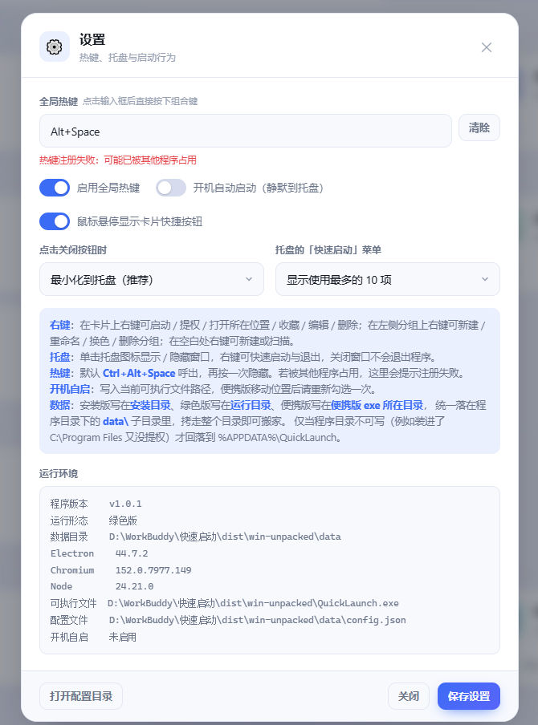

# 快速启动 · QuickLaunch

一个 Windows 桌面启动器：把常用的程序、目录、网址、脚本收进一个干净的面板，
托盘常驻、全局热键一按就出来，拖进去就能加。

<p align="center">
  
</p>

## 特性

| | |
|---|---|
| **托盘常驻** | 关窗口不退出，缩进托盘继续待命；单击托盘/按热键随时呼出 |
| **全局热键** | 默认 `Alt+Space`，可改；呼出即聚焦搜索框 |
| **拖入导入** | 文件 / 文件夹 / 网址直接拖进窗口，自动分类（app / script / dir / url） |
| **长按排序** | 长按卡片 1.5 秒进入拖动模式，拖到新位置松手即重排；拖到底部**垃圾桶**松手删除 |
| **分组管理** | 侧栏「＋ 新建分组」；右键可重命名 / 换颜色 / 删除。删除只在右键菜单里，不占侧栏 |
| **扫描导入** | 扫开始菜单 + 注册表，批量勾选已安装软件一键导入 |
| **两种主题** | 深色 / 浅色，跟随设置持久化 |
| **自绘标题栏** | 无边框窗口 + 内联 SVG 窗口按钮（不依赖系统字体，小字号也清晰） |
| **零网络** | 不联网、不上报；只读写本机配置目录 |

<table>
<tr>
<td></td>
<td></td>
</tr>
<tr>
<td></td>
<td></td>
</tr>
</table>

## 三种发布形态

每次发版都会产出**同一套**三个文件（本地 `dist/` 与 GitHub Release 完全一致）：

| 产物 | 文件名 | 说明 |
|---|---|---|
| **安装版** | `QuickLaunch-Setup-<版本>.exe` | NSIS 安装包。可选安装目录，自动建桌面 + 开始菜单快捷方式，带卸载项 |
| **便携版** | `QuickLaunch-Portable-<版本>.exe` | 单文件绿色 exe，双击即用，不写注册表。数据写在 **exe 所在目录**下 |
| **绿色版** | `QuickLaunch-Green-<版本>.zip` | 解包即用的整个目录，exe 在 zip 根层，解压到哪就在哪跑 |

## 数据存在哪

**数据随程序走** —— 三种形态都把配置写在**程序所在目录**的 `data\` 子目录里，
拷走整个目录（或整个安装目录）就能把配置一起搬走：

| 形态 | 数据落点 |
|---|---|
| 安装版 | `<安装目录>\data\` |
| 绿色版 | `<运行目录>\data\` |
| 便携版 | `Portable\data\`（**exe 所在目录**，不是临时解包目录） |
| 开发模式 | `<项目>\desktop\.tmpdata\userData\` |

只有**程序目录不可写**时（例如装进了 `C:\Program Files` 又没提权），才回落到系统目录
`%APPDATA%\QuickLaunch\`；此时设置面板的「运行环境」会多出一行 `注意` 说明。
首次在程序目录建 `data\` 时，若 `%APPDATA%` 里已有旧配置，会**复制**一份过去（原文件保留，不会删）。

设置面板的「运行环境」会直接告诉你当前落在哪：

<p align="center">
  
</p>

## 下载

到 [Releases](../../releases) 页面取最新版本。国内直连不稳的话把
`github.com` 换成代理镜像即可。

## 从源码构建

需要 Node 18+（推荐 22）。

```bash
cd desktop
npm install
npm start            # 开发运行
npm run check        # 语法 + 工作流自检
npm test             # 主进程逻辑自检（101 项）
npm run release      # = check + test + 打三种产物 + 压绿色版 zip
```

产物落在仓库根目录的 `dist/`：

```
dist/
├── QuickLaunch-Setup-1.0.1.exe
├── QuickLaunch-Portable-1.0.1.exe
├── QuickLaunch-Green-1.0.1.zip
└── win-unpacked/            # 绿色版的原始目录
```

只想出某一种：

```bash
npm run dist:nsis        # 只出安装版
npm run dist:portable    # 只出便携版
npm run dist:dir         # 只出目录
npm run pack:green       # 把 win-unpacked 压成绿色版 zip
```

### CI 发版

推 `v*` tag 会触发 GitHub Actions，在 `windows-latest` 上打三种产物并创建 Release：

```bash
git tag -a v1.0.0 -m "首个版本"
git push origin v1.0.0        # ← 必须推 tag 名，推 main 不会顺带推 tag
```

## 目录结构

```
quicklaunch/
├── desktop/                  # Electron 版（当前主推）
│   ├── src/
│   │   ├── main.js           # 主进程：窗口 / 托盘 / 热键 / 自启 / IPC
│   │   ├── preload.js        # contextBridge 白名单桥
│   │   └── lib/              # 配置读写 / 导入 / 扫描 / 菜单 / 动作
│   ├── renderer/             # 渲染层：index.html + app.js + style.css
│   ├── scripts/              # 打包 & 工作流自检脚本
│   ├── test/smoke.js         # 离线自检
│   └── build/                # 图标源文件（make_icon.py 生成 .ico/.png）
├── web/                      # 遗留 Python 版的 Web UI
├── launcher.py               # 遗留 Python 版：标准库实现的本地 HTTP 启动器
└── Start.bat                 # 遗留 Python 版的一键启动
```

> `launcher.py` + `web/` 是最早的纯 Python 零依赖版本（本地起 8848 端口 + 浏览器 UI）。
> Electron 版是当前维护主线，Python 版保留可跑。

## 安全

* Electron 渲染层 `contextIsolation: true` / `sandbox: true` / `nodeIntegration: false`，
  只通过 `preload.js` 的白名单接口访问主进程。
* 遗留 Python 版只监听 `127.0.0.1`，带一次性 CSRF token。
* 全部数据留在本机 —— 默认写在程序目录的 `data\` 里，不联网、不上传。

## 许可

[MIT](LICENSE)
